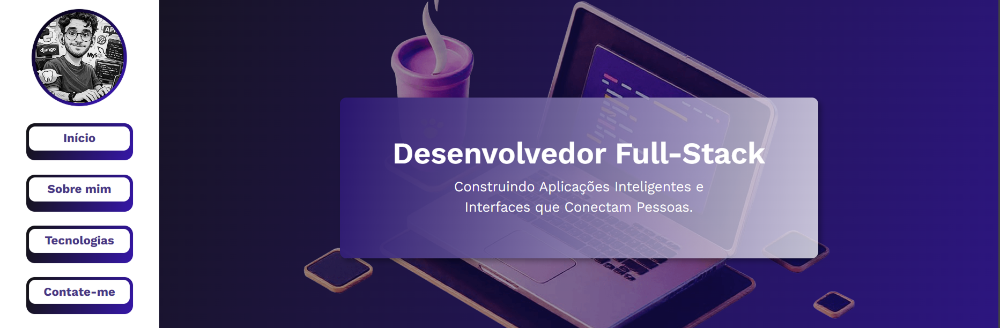
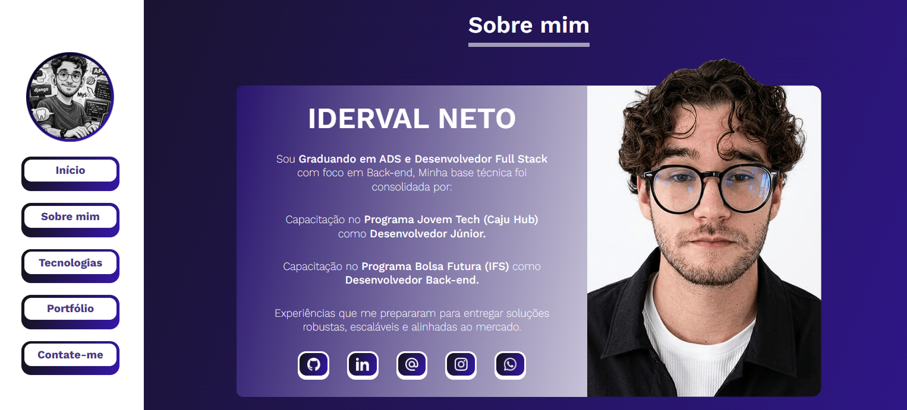
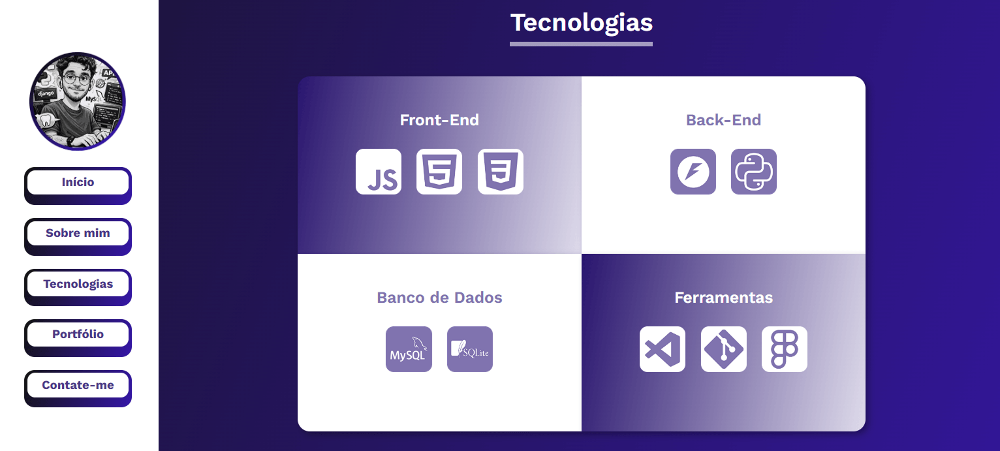
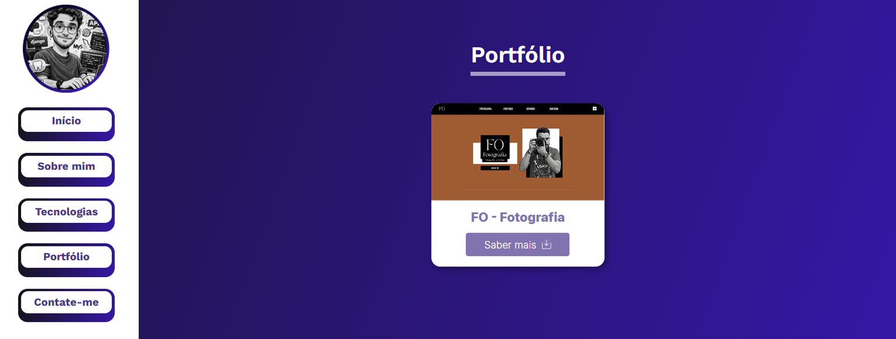

# 🚀 Portfólio Pessoal


> Este é o repositório do meu site pessoal e portfólio de projetos, desenvolvido para apresentar meus <br> serviços, habilidades técnicas e casos de estudo.

## 💻 Sobre o projeto

Site pessoal e profissional, contendo seção de *Portfolio* descrevendo cada projeto e contendo direcionamento para github e deploy, seção de *About* contendo informações profissionais contendo a minha jornada como desenvolvedor, seção de *Serviços* contendo serviços fornecidos e direcionamento de contato e redes sociais. Construido com Html Css e JavaScript.

🌐 <strong>Acesse o site:</strong> <a href="https://iderval-neto-dev.vercel.app" target="_blank" rel="noopener noreferrer">https://iderval-neto-dev.vercel.app</a>

### Seção Home:



### Seção Profissional:



### Seção de Tecnologias:



<!--
### Seção de Serviços:

 -->

### Seção de Portfolio:



## ⚙️ Funcionalidades

- Apresentação sobre quem sou e minha trajetória.
- Vitrine de serviços oferecidos.
- Galeria de projetos inseridos de forma dinamica e com links direcionando para deploy e repositório.
- Botões diretos de contato.

## 🛠️ Tecnologias Utilizadas

**Linguagens:**


**Versionamento:**


**Hospedagem:**


## 📁 Estrutura de Pastas

```bash
iderval-neto-dev/
├── .github/
│   └── assets/             <-- Imagens do README.md
├── script/                 <-- Arquivos JS contendo funcionalidades.
├── src/
│   ├── icon/               <-- Icones do site
│   └── img/                <-- Imagens do site
│       └── portfolio/      <-- Imagens do portfolio separada por categoria
│── style/                  <-- arquivos css com estilizações
├── index.html              <-- arquivo html principal e inicial
└── README.md               <-- Documentação do projeto "Onde você esta agora!"
```

Uma breve explicação da organização dos arquivos:

- `/src`: Pasta separadas contendo imagens e icones utilizado no projeto.

- `style/`: Pasta contendo arquivos css componentizados por seção, home, footer e arquivo<br>css global para alteração de cores e fontes.

- `script/`: Pasta contendo arquivos js cada arquivo com funcionalidade diferente,<br> funcionalidade de troca de tema, acionamento do menu mobile e filtragem de portfolio.

- `/.github`: Pasta contendo imagens utilizadas no arquivo de documentação do projeto<br>Readme.md

## ✍️ Autor

<br>

[](https://iderval-neto-dev.netlify.app)
[](https://wa.me/5588981621337?text=Olá!%20Vim%20pelo%20seu%20github.)
<a href="https://www.instagram.com/n3to_00/" target="_blank"></a>
<a href="https://www.linkedin.com/in/iderval-neto/" target="_blank"></a>
<a href="mailto:neto.dev.12@gmail.com" target="_blank"></a>

---

